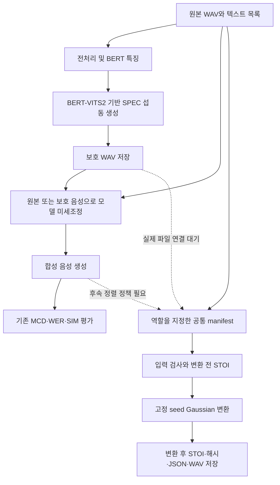

# SafeSpeech 통합 개발 진행 보고서

기준일: 2026-10-27 (한국 시간) · 공유 브랜치: `feature/cpu-experiment-pipeline`

이 보고서는 Git 커밋, 기존 검증 문서, 실행 코드와 Mac 재검증 결과를 종합합니다.
WSL 결과는 2026-10-25 기록에 근거하며 이번 Mac 작업에서 GPU 검증을 반복하지 않았습니다.
팀의 추가 개발 범위는 **환경 구축, SPEC 초기 실행, CPU 공통 실험 기반**입니다.
논문 전체 재현·보호 효과·강건성 검증·모델 학습 완료를 의미하지 않습니다.

## 1. 프로젝트 개요

SafeSpeech는 공개 음성이 원치 않는 음성 합성 학습에 사용되는 상황을 대상으로,
공개 전에 작은 섭동을 적용하는 음성 보호 연구 코드입니다. 원본 저장소는 SPEC
(Speech PErturbative Concealment)과 지각 손실을 결합한 SafeSpeech 경로를 제공합니다.
연구 배경·논문·데모·인용 정보는 [README](../README.md)의 원본 안내에 보존했습니다.

우리 팀은 기존 코드를 유지하면서 담당자들이 같은 입력·설정·결과 형식으로 실험할 수
있는 기반을 확장했습니다. 원본 연구 구현, 팀이 실행 검증한 기능, 앞으로 할 작업을
아래에서 구분합니다.

## 2. 현재 개발 환경

| 항목 | Windows + WSL 환경 (기존 검증) | Mac 환경 (CPU 검증) |
| --- | --- | --- |
| 운영체제 | Windows + WSL2 Ubuntu 22.04 | macOS arm64 / Apple Silicon |
| Python | 3.10.12 | 3.10.11, `.venv` |
| GPU | RTX 5060 Ti 8GB, capability 12.0 | CPU만 사용 |
| PyTorch/TorchAudio | 2.7.1+cu128 / 2.7.1+cu128 | 기존 설치 2.14.1 / 2.11.0, CPU 파이프라인에서 사용하지 않음 |
| CUDA | PyTorch 런타임 12.8 | 사용하지 않음 |
| 주요 의존성 | `requirements-wsl-perturbation.txt` | `requirements-evaluation-smoke.txt` |
| 검증 범위 | GPU 연산·오디오·SPEC 1회/10회 | 오디오 쌍·STOI·Gaussian·runner·자동 테스트 |
| 모델 파일 | 3종 8개, 약 2.58GB 검증 기록 있음 | 해당 가중치 미확보 |

WSL에서는 일반 사용자, 가상환경, 시스템 오디오/빌드 패키지를 구성했습니다.
`python3-venv`, `python3-pip`, `build-essential`, `ffmpeg`, `libsndfile1`을
설치했고 CUDA Toolkit이나 WSL 내부 NVIDIA 드라이버는 별도 설치하지 않았습니다.
기본 사용자 설정 후 WSL 재시작에 따른 적용 확인은 당시 미완료였습니다.

Mac CPU 의존성은 NumPy 1.26.4, SciPy 1.13.1, SoundFile 0.12.1, pystoi 0.4.1입니다.
Mac의 기존 torch/torchaudio import는 확인했지만 서로 다른 버전의 모델 실행 호환성은
보장하지 않습니다. 당시 실행 환경에서 CUDA·MPS 가용성은 모두 False였으며,
이를 Apple Silicon 전체의 MPS 지원 여부로 일반화하지 않습니다.
`.venv-1`의 Python 3.13 환경은 사용하지 않았습니다.

## 3. 전체 시스템 아키텍처



실선은 코드의 데이터 흐름이며 전체 경로의 실행 성공을 뜻하지 않습니다.
미세조정·합성·기존 통합 평가는 팀이 아직 실행 검증하지 않았습니다.

BERT-VITS2는 텍스트·음소·언어·화자 정보·BERT 특징과 음성 스펙트럼을 사용하는
생성 모델입니다. `toolbox.py`는 생성기 및 음성·길이·WavLM 판별기를 구성합니다.
`protect.perturb()`는 생성기를 통해 mel 재구성 손실과 잡음 목표에 대한 재구성·KL
손실을 계산하고 입력 파형의 기울기 부호로 섭동을 갱신합니다.
매 단계 원본 대비 차이를 epsilon으로 제한하고 파형을 [-1, 1]로 제한합니다.
SafeSpeech 모드는 여기에 STOI 기반 미분 손실과 STFT 손실을 추가합니다.
새 CPU Gaussian 변환은 이 SPEC 최적화와 별개인 실험용 변환입니다.

## 4. 날짜별 개발 진행 내역

| 날짜 | 작업·근거 | 완료와 미완료 구분 |
| --- | --- | --- |
| 2025년 원본 커밋 이력 | 데이터 전처리·보호·학습·평가 연구 코드 | 기존 구현이며 이번 팀의 신규 개발로 계산하지 않음 |
| 2026-10-25 | `be448f2`, `feature/integration-setup` | WSL 공통 환경, GPU·오디오 검증, 고정 리비전 모델 다운로드·검사, SPEC 1회/10회 실행 및 문서화 |
| 2026-10-27 | `6c38459`, `feature/cpu-experiment-pipeline` | Mac CPU STOI smoke, Gaussian 공통 모듈, manifest·runner·JSON·자동 테스트·SPEC 가져오기 안내, GitHub 공유 |
| 2026-10-27 본 보고서 | 두 단계의 코드·문서·커밋 재검토와 Mac 재검증 | 통합 현황·팀원 시작 순서 정리. WSL 재실행 및 실제 SPEC 파일 전송은 하지 않음 |

현재 브랜치는 `feature/integration-setup`의 작업을 이력으로 포함합니다.
기존 문서의 “커밋·Push 미수행”은 각 문서 작성 시점의 기록입니다.
이후 위 두 커밋은 GitHub에 공유되었으며, 다른 브랜치나 main으로 병합한 것은 아닙니다.

## 5. 구현 완료 기능

| 구분 | 완료 내용 |
| --- | --- |
| WSL 공통 기반 | 분리된 의존성 목록, GPU·오디오 점검 스크립트 |
| 모델 준비 도구 | BERT-VITS2·DeBERTa·WavLM 고정 리비전, 크기·해시 검증, 기존 파일 보존 |
| SPEC 초기 실행 도구 | 입력 복사, 영어 BERT 특징, 원본 생성기·섭동 함수 실행, 범위 검사, 결과 저장 |
| 독립 STOI | 모델을 불러오지 않는 mono 음성 쌍 검사와 표준 STOI |
| 변환 모듈 | 로컬 RNG의 Gaussian 잡음, seed·std 검사, clip, 입력 배열 보존 |
| Manifest v1 | original/protected/synthetic 역할, 기준·대상 선택, strict 정렬, 상대 경로 해석 |
| 공통 runner | 변환 전후 점수, 입력 전후 SHA-256, 변환 WAV와 해시, 환경·설정 JSON |
| 자동 검증 | 입력 불변성, seed 재현성, 오류 거부 등 9개 테스트 |
| SPEC 연결 준비 | 실제 파일 가져오기 안내와 파일 미확보 상태의 manifest |

기존 Gaussian 대조 연산과 오디오/STOI 함수를 각각 공통 모듈로 추출했으며,
기존 smoke와 runner가 재사용합니다. 핵심 연구 코드를 복제하거나 수정하지 않았습니다.

## 6. 실제 실행 및 검증 결과

### 6.1 WSL에서 검증한 결과 (2026-10-25 기록)

`nvidia-smi`, CUDA 행렬곱·합성곱 역전파·STFT, WAV 저장/복원·리샘플링·mel,
패키지 의존성 검사, 8개 모델 파일 무결성, 오프라인 `protect.py` import를 확인했습니다.
입력은 `data/LibriTTS/5339/5339_14134_000092_000003.wav`입니다.

| 항목 | SPEC 1회 | SPEC 10회 |
| --- | --- | --- |
| 배치 / 길이 | 1 / 약 1.02초 | 1 / 약 1.02초 |
| BERT 특징 | (1024, 33) | (1024, 33) |
| epsilon | 8/255 | 8/255 |
| 최대 섭동 절댓값 | 약 0.00313726 | 약 0.03137255 |
| 최고 GPU 텐서 할당 메모리 | 약 602.59MiB | 약 614.39MiB |

손실 유한값과 섭동 범위를 확인했습니다. float32 허용 오차는 `epsilon + 1e-7`입니다.
10회 저장 음성은 24kHz·24,481 samples입니다. GPU 수치는 PyTorch 텐서 할당량이며
전체 GPU 메모리나 장시간 발화의 요구량이 아닙니다.
전체 CLI의 판별기·WavLM 초기화까지 검증한 것은 아닙니다.

### 6.2 Mac CPU에서 검증한 결과 (2026-10-27 재실행 포함)

| 항목 | 결과 |
| --- | --- |
| 원본 대 원본 STOI | 0.9999999999999997 |
| 원본 대 Gaussian 대조군 STOI | 0.970284020573383 |
| Gaussian 설정 | seed 42, std 0.005, 평균 0, 진폭 clip [-1, 1] |
| 변환 전후 STOI 차이 | -0.029715979426616634 |
| 자동 테스트 | 9개 통과 (기존 smoke 3개 + runner/변환 6개) |
| 의존성 검사 | `pip check` 통과 |
| 실제 SPEC 보호 음성 STOI | 파일 미확보, 미실행 |

테스트는 동일 seed의 지표·출력 WAV 해시 일치, 다른 seed의 출력 변화, 입력 파일
바이트·배열 불변성, JSON 재읽기, 상대 경로·역할 선택, 잘못된 입력 거부를 확인합니다.
초기 SoundFile float WAV의 PEAK 청크 생성 시각 때문에 파일 해시가 달라져
runner 저장을 SciPy float64 WAV로 바꿨습니다. 별도 실제 실행 두 번에서도 해시와
지표 일치, 저장 WAV 재평가 결과의 JSON 일치를 확인했습니다.
생성 시각·출력 디렉터리는 매번 달라지므로 JSON 전체 바이트 일치를 주장하지 않습니다.
의존성/운영체제가 다른 환경 간 완전한 비트 단위 재현성은 미검증입니다.

로컬 결과는 `runs/experiment_2c6x6lr2/report.json` 등이며 Git에 포함하지 않습니다.
본 보고서 작성 시 재실행 결과는 `runs/experiment_d16rhrty/report.json`,
독립 smoke 결과는 `runs/evaluation_smoke_b95_n4aq/report.json`에 저장했습니다.
새 clone에서는 실행해서 자신의 결과를 생성해야 합니다.

## 7. 주요 코드와 파일 구조

| 경로 | 역할 |
| --- | --- |
| `protect.py`, `save_audio.py` | 기존 섭동 생성·보호 음성 저장 |
| `bert_gen.py`, `preprocess_text.py` | 기존 특징·텍스트 전처리 |
| `train.py`, `toolbox.py`, `bert_vits2/` | 기존 모델 학습·구성·구현 |
| `evaluate.py`, `asr.py` | 기존 합성 평가·음성 인식 경로 |
| `filelists/`, `data/LibriTTS/5339/` | 기존 텍스트 목록과 음성 데이터 |
| `scripts/check_gpu_audio.py` | WSL CUDA·오디오 점검 |
| `scripts/download_setup_models.py` | 고정 모델 다운로드·무결성 검사 |
| `scripts/smoke_perturbation.py` | CUDA SPEC 단일 음성 초기 실행 |
| `scripts/audio_metrics.py` | 공통 오디오 검사·strict STOI |
| `scripts/robustness_transforms.py` | Gaussian 변환 |
| `scripts/smoke_evaluation.py` | 독립 STOI smoke |
| `scripts/run_experiment.py` | manifest 실험 runner |
| `scripts/test_smoke_evaluation.py`, `scripts/test_run_experiment.py` | 자동 테스트 |
| `experiments/gaussian_smoke.json` | 실행 가능한 원본 대조군 |
| `experiments/spec_gaussian_pending.json` | 실제 SPEC 파일 연결 대기 |
| `requirements-evaluation-smoke.txt`, `requirements-wsl-*.txt` | 용도별 의존성 목록 |

## 8. 팀원 시작 순서와 실행 방법

먼저 이 보고서로 범위를 확인하고, CPU 담당자는 [공통 파이프라인 안내](EXPERIMENT_PIPELINE_KO.md),
GPU 담당자는 [WSL 시작 안내](QUICKSTART_KO.md)를 읽습니다.

### 8.1 Clone과 브랜치 선택

```bash
git clone --branch feature/cpu-experiment-pipeline https://github.com/graceyoon35-cmd/SafeSpeech.git
cd SafeSpeech
```

저장소 접근 권한이 필요합니다. 가상환경·모델·실행 결과는 clone으로 전달되지 않습니다.
이미 clone한 팀원은 로컬 변경을 보존하고 해당 브랜치를 선택합니다.

### 8.2 Mac CPU 공통 실험

Python 3.10이 설치되어 있다는 전제입니다. 기존 `.venv`가 있으면 다시 만들지 않습니다.
아래 설치 명령은 새 팀원용이며, 이번 검증에서는 기존 환경을 재사용했습니다.

```bash
python3.10 -m venv .venv
.venv/bin/python -m pip install -r requirements-evaluation-smoke.txt
.venv/bin/python -m pip check
.venv/bin/python scripts/smoke_evaluation.py
.venv/bin/python scripts/run_experiment.py experiments/gaussian_smoke.json
.venv/bin/python -m unittest discover -s scripts -p 'test_*.py' -v
```

저장소 루트에서 실행합니다. CPU 경로에는 torch·CUDA·모델 가중치가 필요 없습니다.
결과는 새 `runs/experiment_*`에 저장됩니다. manifest 경로는 manifest 디렉터리
기준이며, 비교할 음성은 같은 sample rate·샘플 수를 가진 1초 이상 mono여야 합니다.

### 8.3 Windows + WSL CUDA 섭동 개발

Windows 터미널이 아닌 **WSL Ubuntu 터미널**에서 진행합니다.
시스템 패키지·계정 설정·전체 설치 순서는 [QUICKSTART_KO.md](QUICKSTART_KO.md)를 따릅니다.
일반 사용자로 저장소 루트에서 해당 WSL 가상환경을 활성화한 후:

```bash
python -m pip install torch==2.7.1 torchaudio==2.7.1 --index-url https://download.pytorch.org/whl/cu128
python -m pip install -r requirements-wsl-perturbation.txt
python -m pip check
python scripts/check_gpu_audio.py
python scripts/download_setup_models.py
python scripts/smoke_perturbation.py --iterations 10
```

기존 설치가 검증되어 있으면 재설치·재다운로드를 반복할 필요가 없습니다.
이 조합은 기록된 WSL GPU에서 검증했으며 다른 GPU의 실행은 별도 확인해야 합니다.
WSL 목록은 NumPy 1.23.5, CPU 목록은 1.26.4를 사용하므로 같은 가상환경에
혼합 설치하지 않습니다. Mac에서 CUDA smoke나 학습을 실행하지 않습니다.

### 8.4 실제 SPEC 파일 확보 후

[SPEC 파일 가져오기 안내](SPEC_PAIR_IMPORT_KO.md)에 따라 WSL 동일 실행 폴더의
원본 복사본·`protected.wav`·`report.json`을 전송하고 해시·출처를 확인합니다.
그 후에만 다음을 실행합니다.

```bash
.venv/bin/python scripts/run_experiment.py experiments/spec_gaussian_pending.json
```

현재 Mac에 해당 파일이 없어 이 명령은 missing file 오류로 종료됩니다.
원본이나 Gaussian 대조군을 보호 음성으로 대체하지 않습니다.

## 9. 발견된 문제와 제약 사항

| 항목 | 확인 내용 및 영향 |
| --- | --- |
| 화자 임베딩 | 공개 `G_0.pth`에 `emb_g.weight` 누락. 원본 로더와 같이 seed 초기화 유지; 구성 합의 필요 |
| WER 구현 | `evaluate.py`가 짝수 원본 행을 건너뛰어 `WER_gt`가 0으로 남음. 미수정 |
| 모델 파일 검사 | `assert os.listdir(hps.model_dir) != 4`는 파일 수 검사가 아님. 미수정 |
| 학습 설정 | LibriTTS JSON batch 16을 CLI 기본 64가 덮어씀. 24kHz, 화자 수 850, 100 epochs 설정은 실행 증거가 아님 |
| 장치 의존성 | 기존 학습/보호 코드는 CUDA AMP·backend 설정을 사용. CPU 옵션 존재만으로 Mac 전체 학습 호환성을 보장하지 않음 |
| Mac 자원 | 학습 목록 108개 원본 WAV는 있으나 대응 BERT 특징 0개, 필요한 모델 가중치 없음 |
| 합성 평가 준비 | 기본 모델 외에 미세조정 체크포인트가 필요. `evaluate.py`는 epoch 100 결과 경로를 기대 |
| 데이터셋 | CMU 설정은 있으나 해당 filelist는 현재 없음. 테스트 목록 26행은 실행한 합성 평가 수가 아님 |
| 지표 의미 | 표준 pystoi STOI와 `torch_stoi`의 학습용 손실은 다름. SIM을 파형 유사도로 대체할 수 없음 |
| ASR 명칭 | 기존 SIM 출력의 ASR은 화자 검증 판정 비율이며 Whisper 음성 인식과 구분 필요 |
| strict 입력 | 스테레오·무음·NaN·진폭 초과·짧은 음성·쌍 불일치를 거부. STOI 경고도 실패 처리 |
| 실행 기록 | JSON에 절대 경로 포함. 외부 공유 시 개인 경로를 확인해야 하며 로컬 JSON은 업로드하지 않음 |
| 저장 실패 | 출력 I/O 실패 시 부분 실행 폴더가 남을 수 있음 |

이번 문서 작업은 위 핵심 코드 결함을 수정하지 않습니다.

## 10. 향후 기능과 우선순위

| 순위 | 후속 작업 | 완료 기준 |
| --- | --- | --- |
| P0 | 실제 WSL SPEC 음성 전송·출처 확인 | 동일 실행의 원본·보호·보고서 확보 및 전송 해시 확인 |
| P1 | 실제 SPEC 쌍 CPU 실험 | 보호 전후와 Gaussian 적용 후 STOI·해시 기록, 원본 대조군과 분리 |
| P1 | 공통 계약 팀 합의 | 역할·발화 ID·sample rate·정렬·seed·변환 파라미터 확정 |
| P2 | 사전 점검 CLI | 모델·특징·목록·체크포인트 존재를 기계적으로 보고 (현재 미구현) |
| P2 | 평가 독립화·SIM 최소 검증 | 고정 ECAPA 모델 준비, 단일 쌍 sanity check, WER 결함 수정·검증 |
| P2 | 추가 강건성 변환·배치 실험 | 변환 파라미터 기록, 여러 발화·seed 결과 집계 |
| P3 | 모델 학습·합성 최소 실행 | 임베딩·체크포인트·특징 준비 후 CUDA 작은 배치 검증 |
| P3 | 보호 효과·논문 재현 | 긴 음성·전체 데이터·200회·SafeSpeech 및 합성 결과 비교 |

위 표는 계획이며 완료로 계산하지 않습니다.

## 11. 팀원별 연동 사항

| 담당 영역 | 전달·합의할 내용 |
| --- | --- |
| 섭동 생성 담당 | 실제 원본/보호 WAV, SPEC 모드·iterations·epsilon·seed·생성 보고서 제공 |
| 평가 담당 | 기준/대상 역할, 표준 STOI와 학습 손실 구분, SIM 모델 리비전, WER·MCD 정책 |
| 강건성 담당 | Gaussian 공통 함수 재사용, 추가 변환의 인터페이스·단위·seed·clip 정책 |
| 모델 담당 | `emb_g.weight`, 화자 ID, 사전학습 파일, BERT 특징, 학습/합성 산출물 경로 |
| 공통 기반 | manifest 버전·실패 처리·JSON 필드·테스트 유지, OS별 환경 분리 |

개인별 이름이나 아직 정해지지 않은 역할 배정은 이 문서에서 추정하지 않습니다.

## 12. 완료 범위와 미완료 범위

**완료:** WSL 환경과 제한된 SPEC 실행 확인, Mac CPU 독립 STOI, Gaussian 공통 변환,
역할 기반 manifest·runner·JSON·WAV 저장, 동일 환경 재현성·입력 불변성 검증,
9개 테스트, 실제 SPEC 파일 연결 절차, 팀 공유용 문서와 브랜치 준비.

**미완료:** Mac의 실제 SPEC 파일 확보와 해당 STOI 평가, 전체 보호 CLI·SafeSpeech·200회,
전체 데이터 생성, SIM/MCD/WER 실행, 합성 정렬, 추가 강건성 변환·대규모 집계,
모델 학습·합성 실행, 보호 효과·논문 재현, 다른 팀원 PC의 신규 설치 검증.

기존 실험 기록은 [WSL 총정리](SETUP_VALIDATION_SUMMARY_KO.md),
[WSL 상세 이력](WSL_SETUP_KO.md), [초기 공통 점검](COMMON_FOUNDATION_REVIEW_KO.md),
[CPU 실험 안내](EXPERIMENT_PIPELINE_KO.md), [SPEC 연결 안내](SPEC_PAIR_IMPORT_KO.md)를 참조합니다.
이 문서가 누적 진행 상황의 최신 진입점입니다. 모델·가상환경·실행 결과·인증정보는
새 문서 커밋에 포함하지 않으며 현재 브랜치에만 공유합니다.
