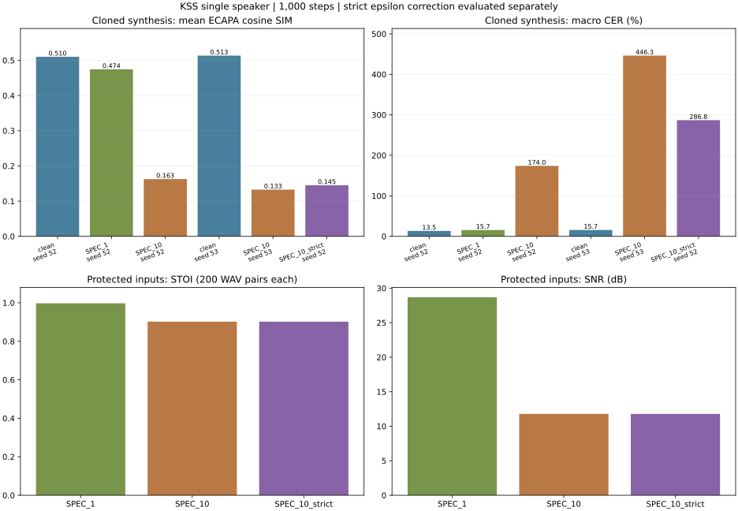

# SPEC 연구 개발 최종 보고서 — 2026-11-20

생성·학습·방어 성능 평가 및 앱팀 오프라인 인계 준비를 완료했다. 11월 19일 보고서의 보정본 SIM·CER 미측정 항목은 아래 별도 실험으로 갱신한다. 기존 실험·체크포인트·백업은 보존했다.

## 검증된 성과

- KSS 200개, 분할 140/30/30, 단일 화자, 동일 초기 생성기, batch 1, BF16, segment 8192, AdamW 0.0001, 1,000-step 제한 실험이다.
- seed53 기존 평가 90건과 보정본 평가 90건의 WAV 해시·문장·합성 seed·독립 편집거리·macro 및 corpus CER를 검산했다. 두 평가의 SIM도 ECAPA 재인코딩으로 검산했다.
- 기존 증거 2140개 파일의 SHA256이 유지됐다. 신규 보정본만 별도 학습했고 Clean은 기존 seed52 체크포인트를 재사용했다.

## 최종 복제 합성 평가

SIM은 고정된 clean 학습 음성 5개에 대한 ECAPA cosine 평균이다. CER는 30개 테스트 발화별 비율의 평균(macro), corpus CER는 문자 수 가중 전체 비율이다. 낮은 SIM·높은 CER는 본 복제 실험에서 방어 방향이지만 차단 성공률은 아니다.

| 학습 seed | 입력 조건 | SIM | macro CER | corpus CER |
|---:|---|---:|---:|---:|
| 52 | clean | 0.5099738 | 13.4606% | 12.1581% |
| 52 | SPEC_1 | 0.4744760 | 15.7133% | 16.7173% |
| 52 | SPEC_10 | 0.1627789 | 174.0339% | 181.7629% |
| 53 | clean | 0.5134293 | 15.7430% | 14.8936% |
| 53 | SPEC_10 | 0.1328125 | 446.3187% | 444.3769% |
| 52 | SPEC_10_strict | 0.1451893 | 286.7974% | 310.9422% |

## ε 보정 전후의 차이

기존 SPEC_10은 PCM16 저장 반올림으로 200개 모두 엄격한 ε=8/255를 최대 1 LSB 이내 초과했다. ε+1/32768를 허용하던 기존 검증에서는 통과했다. 원본 파일은 수정하지 않았다. 정수 투영 보정본은 원본 PCM16 대비 floor(ε×32768)=1028 code 이내로 제한한다.

| 보호 입력 | 개수 | 평균 STOI | 평균 SNR (dB) | 최대 진폭 차이 | 엄격한 ε 초과 |
|---|---:|---:|---:|---:|---:|
| SPEC_1 | 200 | 0.9973078 | 28.6835017 | 0.003143310546875 | 0 |
| SPEC_10 | 200 | 0.9016711 | 11.7870250 | 0.031402587890625 | 200 |
| SPEC_10_strict | 200 | 0.9017007 | 11.7890859 | 0.031372070312500 | 0 |

보정본은 섭동을 새로 최적화한 결과가 아니라 기존 SPEC_10의 저장 단계 정수 투영 사본이다. seed52·분할·텍스트 특징·초기 가중치·모델·학습 설정을 유지하고 WAV 경로·해시, manifest/list 경로, 조건 이름만 바꾸었다. 같은 30문장과 합성 seed 2026~2055, Whisper small 기본 한국어 decoder를 사용했다.

보정 후 Clean 대비 방어 방향(낮은 SIM·높은 CER) 동시 충족: **관측됨**. 보정본 SIM 0.1451893, macro CER 286.7974%. 한 번의 추가 학습이므로 기존 대비 차이를 저장 보정만의 인과 효과로 해석할 수 없다. CUDA 학습 변동이 함께 포함된다.

## ASR 민감도와 GPU 재현 범위

CER 100% 초과는 반복 전사의 삽입 오류를 포함한 유효한 편집거리 비율이다. 주 결과에서 잘라내거나 상한 처리하지 않았다. 기존 seed52 SPEC_10의 짧은 발화 decoder 민감도 결과는 174.0339% → 115.3416%다. 이는 사후 별도 분석이며 주 결과를 대체하지 않는다. seed53 및 보정본에는 이 추가 decoder 분석을 수행하지 않았다. 발화별 삽입 수·최대 CER 전사 미리보기는 final_verification.json에 보존했다.

기존 동일 seed GPU 보호 두 실행은 76,205샘플이 달랐고 출력 간 최대 차이는 0.050201416015625였다. 각 출력은 입력 대비 엄격한 ε를 만족했다. 강제 결정론은 reflection_pad1d_backward_out_cuda의 결정론 구현 부재로 실패했다. 해당 연산을 유일 원인으로 단정하지 않는다. 실패 로그를 보존했고 추가 장시간 해결을 시도하지 않았다. 같은 seed는 바이트 동일성 보장이 아니다. 재현 범위는 이 고정 환경·동일 화자·짧은 제한 학습에서 방어 지표 방향을 확인한 수준이다.

## 테스트와 앱팀 전달

- 2026-11-20 전체 자동 테스트 99개 PASS, pip check PASS.
- 실제 WAV→보호 WAV GPU 실행 PASS: 141,123샘플, mono 44,100Hz PCM16, 최대 차이 0.0313720703125, STOI 0.8888067, SNR 11.494176dB.
- 최종 저장 WAV를 독립 재계산했고 입력 해시 보존, 기존 출력 폴더 재사용 거부(exit 1), 기존 결과 해시 보존을 확인했다.
- 실행·의존성·입출력·예제 경로: [앱팀 README](README_SPEC_HANDOFF_20261120_KO.md). UI·프론트엔드는 앱팀 범위다.

## 한계

- 단일 화자, 두 원래 학습 seed, 보정본 학습 seed 하나, 단일 대리·복제 모델, 1,000-step 제한이다. 장기 수렴·다화자·다른 공격 모델로 일반화하지 않는다.
- 사람 청취 검수 미완료, 사전학습 코퍼스 비중복 미확인이다. STOI/SNR은 보호 입력, SIM/CER는 복제 합성이므로 같은 품질 지표로 섞지 않는다.
- SPEC_10의 보호 입력 STOI 약 0.902와 SNR 약 11.79dB는 품질 비용을 보인다. 무손실·불가청·복제 불가능으로 발표하지 않는다.

## 미해결 사항

- GPU 바이트 동일성 및 강제 결정론 실행 실패.
- 독립 섭동 seed 반복, SPEC_1 추가 학습 seed, 보정본 두 번째 학습 seed, 보정본 decoder 민감도는 미실행.
- CPU 실행 성능 및 새 기기의 전체 신규 설치는 미검증. 앱 UI·비동기 실행·배포 연결은 앱팀 담당.
- 별도 화자 동의·음성/가중치 외부 공개 승인을 확보한 것으로 기록하지 않는다. 기존 KSS 내부 비상업적 연구 범위를 유지한다.

## 발표 그래프

CSV·PNG·SVG 및 재검산 색인은 runs/final_validation_20261120/presentation/에 있다. Git·백업 인계 상태는 SPEC_RELEASE_STATUS_20261120_KO.md에 별도로 기록한다.
