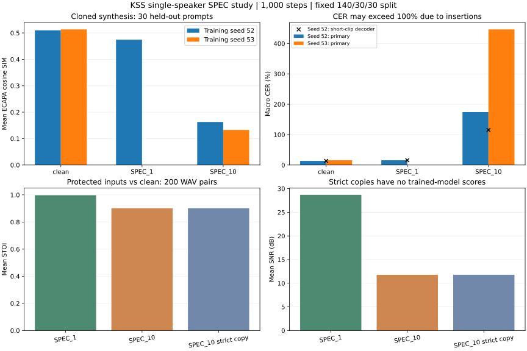

> **보관 문서**: 작성 당시 개발 상태·수치를 담은 기록입니다. 현재 실행은 [앱팀 실행 가이드](../README_SPEC_HANDOFF_20261120_KO.md), 연구 결론은 [최종 보고서](../SPEC_FINAL_REPORT_20261120_KO.md)를 확인하세요.

> 11월 19일 시점의 기록입니다. ε 보정본 추가 학습·평가를 포함한 최신 결과는 [2026-11-20 최종 보고서](../SPEC_FINAL_REPORT_20261120_KO.md)와 [앱팀 명세](../README_SPEC_HANDOFF_20261120_KO.md)를 확인하세요.

# SPEC 최종 결과 보고서 — 2026-11-19

기존 결과·원본·가중치·백업을 보존하고 별도 경로에서 검증했다. 앱 UI·서버·프론트엔드는 변경하지 않았다. 새 연구 브랜치 `research/spec-final-validation-20261119`를 사용한다.

## 기존 결과 검증

세 조건은 동일 생성기 초기 가중치(SHA256 `48e3ff3fd0b5348e095f0468e60ae727507564100f58142ef3a922ead6e0a4d0`), seed 52, AdamW LR 0.0001, batch 1, BF16, segment 8192, 1,000-step을 사용한다. 파형·길이 판별기는 동일 seed의 무작위 초기화다. 실제 trainer는 고정 순서로 발화를 순회하며, 공식 Melo 모듈·손실을 사용하는 제한된 trainer다. config의 epoch/LR decay 값이 전체 공식 학습 루프 실행을 뜻하지 않는다.

원본 200개 및 train/validation/test 140/30/30의 ID·대본·특징·WAV 해시를 대조했고 분할 간 정규화 대본 중복이 없었다. 평가에는 동일 test 30문장, 합성 seed 2026~2055, 동일 clean train 기준 WAV 5개를 사용했다. SIM은 ECAPA cosine 5개 평균 후 문장 평균이다. 저장 WAV 120개를 재인코딩한 SIM의 원래 값 대비 최대 차이는 0.0이다.

CER는 공백·문장부호를 제거한 영문/숫자/한글 완성형 문자열의 (치환+삭제+삽입)/정답 문자 수다. 대소문자 변환이나 자모 분해는 적용하지 않는다. jiwer와 별개인 편집거리 구현으로 120건을 검산했으며 산술 오류는 없었다. 주 결과는 발화 CER의 단순 평균(macro)이고, 전체 문자 기준 corpus CER를 별도 표기한다.

| seed | 조건 | SIM | macro CER | corpus CER | 입력 STOI | 입력 SNR(dB) |
|---:|---|---:|---:|---:|---:|---:|
| 52 | clean | 0.5100 | 13.46% | 12.16% | 1.0000 | ∞ (원본 동일) |
| 52 | SPEC_1 | 0.4745 | 15.71% | 16.72% | 0.9973 | 28.68 |
| 52 | SPEC_10 | 0.1628 | 174.03% | 181.76% | 0.9017 | 11.79 |
| 53 | clean | 0.5134 | 15.74% | 14.89% | 1.0000 | ∞ (원본 동일) |
| 53 | SPEC_10 | 0.1328 | 446.32% | 444.38% | 0.9017 | 11.79 |

SIM·CER는 복제 모델의 합성 음성 30문장 지표이며 STOI·SNR는 원본 대 보호 입력 200쌍 지표다. Clean의 STOI=1, SNR=∞는 원본 자신과 비교한 항등 기준이다. seed53의 입력 품질은 같은 WAV를 재사용하므로 동일하다.

## CER 174.03% 원인과 디코더 민감도

SPEC_10에서 삽입 291·삭제 57·치환 250개, 100% 초과 발화 7개를 확인했다. `kss_hf_09826`은 정답 13자에 반복 ASR 출력으로 삽입 210·치환 13개가 발생해 CER 1,715.38%였다. `kss_hf_03111`도 반복 출력으로 삽입 64·치환 10개/정답 10자, CER 740%였다. 열화된 합성 음성에서 ASR 반복·환각이 수치를 증폭시킨 것이며, 이를 복제 차단 성공률로 해석하지 않는다.

| 조건 | 기존 macro CER | 짧은 발화 decoder macro CER |
|---|---:|---:|
| clean | 13.46% | 13.46% |
| SPEC_1 | 15.71% | 15.71% |
| SPEC_10 | 174.03% | 115.34% |

Whisper small·한국어·temperature 0을 유지하고 모든 120개 WAV에 `sample_len=64`, `condition_on_previous_text=False`를 동일 적용했다. SPEC_10은 174.03% → 115.34%이며 Clean·SPEC_1은 그대로다. 사후 디코더 민감도 분석이며, 계산 오류 정정값이나 사전 등록된 주 결과의 대체값이 아니다. 표본 제거·CER 상한 처리·원본 결과 덮어쓰기는 하지 않았다. seed53은 원래 decoder 설정으로 평가했다.

## 실제 보호 WAV와 엄격한 ε 수정

| 조건 | 파일 수 | 평균 STOI | 평균 SNR | 최대 진폭 차이 | 엄격한 ε 초과 | PCM16 허용오차 기준 실패 |
|---|---:|---:|---:|---:|---:|---:|
| SPEC_1 기존 | 200 | 0.997308 | 28.683502 | 0.003143310546875 | 0 | 0 |
| SPEC_10 기존 | 200 | 0.901671 | 11.787025 | 0.031402587890625 | 200 | 0 |
| SPEC_10 정수 보정 사본 | 200 | 0.901701 | 11.789086 | 0.031372070312500 | 0 | 0 |

모두 44,100Hz mono PCM16이며 원본·보호 파일의 clipping rail 샘플은 0개다. 기존 STOI 재계산 차이는 0이다. ε=8/255(0.03137254901960784)이며 기존 저장기는 PCM16 반올림으로 SPEC_10 200개 모두 엄격한 ε를 1 LSB 이내 초과했다. 기존 validator가 허용하던 ε+1/32768 기준에서는 통과한다. 이 차이를 숨기지 않고 엄격한 기준과 저장 오차 허용 기준을 구분했다.

새 앱팀 실행기는 원본 정수 샘플 대비 floor(ε×32768) 이내로 투영해 엄격한 ε를 보장한다. 보정 사본 200개의 ε 초과와 clipping은 0이다. **보정된 입력으로 학습한 SIM·CER는 미측정**이며 위 모델 점수는 보정 전 입력으로 학습한 결과다.

## 추가 seed 재현성

seed 53에서 Clean·SPEC_10을 각각 1,000-step 재학습하고 동일 30문장으로 평가했다. 학습 seed만 변경했고 섭동 seed 52와 기존 보호 WAV, 분할, 초기 가중치, 합성 seed를 유지했다. 추가 seed에서는 중간 체크포인트를 생략하고 최종 1,000-step 체크포인트만 저장했다. SPEC_1 추가 반복 및 두 번째 추가 seed는 우선순위에 따라 생략했다.

사전학습 모델 재합성 WAV의 원래 baseline 대비 동일 해시는 30/30개다. 원래 pretrained SIM/CER는 0.2453/7.25%, 재평가 baseline은 0.2453/7.25%다.

추가 seed에서도 SPEC_10의 낮은 SIM·높은 CER 방향이 재현됐다.
단일 화자·총 두 학습 seed의 제한된 결과이며 다화자·장기 학습·다른 복제 모델에 대한 일반화 근거가 아니다. cuDNN benchmark는 꺼져 있으나 전체 CUDA 결정론을 강제하지 않아 모든 환경에서 비트 단위 재현을 보장하지 않는다.

평가 문장·개별 seed·체크포인트 경로는 `audit_strict/evaluation_prompts.csv`, `audit_strict/audit.json`, `seed53_evaluation_location.json`과 해당 평가 `per_file.csv`에 있다.

## 인계·테스트·보존

앱팀 명령은 `docs/archive/README_SPEC_HANDOFF_20261119_KO.md` 및 `scripts/example_spec_protect.sh`에 있다. `scripts/protect_wav.py`로 실제 KSS 입력부터 보호 WAV까지 GPU 실행했다. 최종 실행기 스모크: 141,123샘플·44.1kHz PCM16, 최대 차이 0.0313720703125, STOI 0.8874569446, SNR 11.639769dB. 증거는 `final_cli_checks.json`이다.

전체 자동 테스트 99개 PASS (`tests_release.log`), `pip check` PASS. 실제 WAV 품질 검사·CER 독립 계산·SIM 재인코딩·GPU 스모크와 자동 테스트는 각각 별도 증거다. GPU 바이트 동일성 검사 및 결정론 실행은 실패했다. 최종 Git 공백·추적 파일 검사와 push 상태는 인계 종료 기록에 추가한다.

기존 약 29GB 백업·체크포인트·실험 폴더는 변경하지 않았다. 새 체크포인트는 `/home/safespeech/experiments/SafeSpeech-KSS-final-20261119/`, 새 검증·보정 사본·발표 자료는 `runs/final_validation_20261119/`에 저장했다. 데이터·WAV·가중치·ZIP·환경 원본 로그는 Git에 올리지 않는다.

## 미해결·해석 제한

- 기본 GPU 보호 실행은 같은 seed의 바이트 동일 재현에 실패했다. 두 실행의 76,205샘플이 달랐으며 최대 상호 차이는 0.050201416015625다. 각 출력은 엄격한 ε를 통과했다.
- 결정론 강제 실행은 reflection_pad1d_backward_out_cuda의 결정론 구현 부재로 실패했다. handoff_repeat_mismatch.json·deterministic_repeat.json과 로그를 보존했다. 비결정론 연산 지원 문제는 확인했으나 차이의 단일 원인으로 확정하지 않았다.
- 엄격한 ε 보정 입력으로의 모델 재학습·SIM/CER, 독립 섭동 seed 반복, SPEC_1 추가 seed는 미실행이다.
- KSS 단일 화자, 사람 청취 미검수, 사전학습 코퍼스와 KSS의 비중복 미확인 상태다.
- 낮은 SIM·높은 CER를 실제 서비스의 복제 불가능 또는 공격 성공률로 바꾸어 보고하지 않는다.
- 앱 UI·서버·프론트엔드 연결은 앱팀 담당이며 이번 작업에 포함하지 않았다.
- 음성·가중치 외부 공개 승인 및 별도 화자 동의는 확보한 것으로 기록하지 않는다.

## 발표 그래프

## 새 seed 체크포인트

- seed 53 clean: `/home/safespeech/experiments/SafeSpeech-KSS-final-20261119/melo_train_clean_4evykwdc/checkpoints/step_001000/G_1000.pth` (SHA256 `2b842c5963a2e94bd568f1c8b22e532ae9a2705a6a81bb2df447104511632f0b`).
- seed 53 SPEC_10: `/home/safespeech/experiments/SafeSpeech-KSS-final-20261119/melo_train_SPEC_10_qldq233b/checkpoints/step_001000/G_1000.pth` (SHA256 `064bdfdc0e1e0c3541b76ede2d034a6d16b8ccb1f12cf803913f89fe6b6041b1`).

기계 판독 색인: `runs/final_validation_20261119/presentation/report.json`. 기존 seed52 체크포인트 경로·해시는 `audit_strict/audit.json`에 보존했다.
